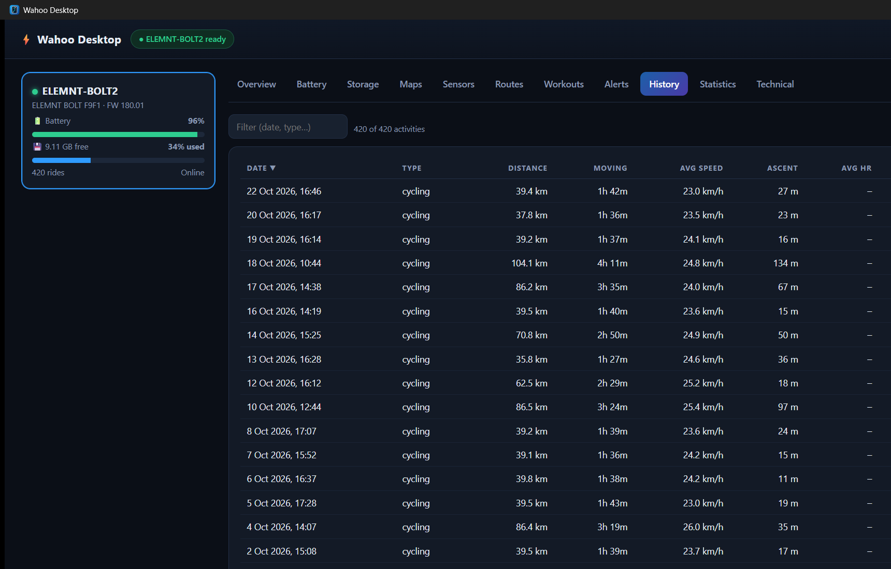

<p align="center"></p>

# Wahoo Desktop

## Introduction

Wahoo Desktop is a fast, local Rust app that reads a Wahoo ELEMNT (tested with an ELEMNT BOLT2) over **USB (MTP)** and shows everything it can find in a clean native window: firmware, battery, storage, installed maps, sensors, routes, workouts, alerts, ride history and statistics. No cloud account, no phone and no web server are needed; files are mirrored to a local cache so the UI is instant and works offline.

**Platform:** Windows only for now (native WPD COM API). macOS/Linux are planned. This is version 0.1.

### Screenshots

| Maps | Sensors | History |
| --- | --- | --- |
|  |  |  |

## Installation

**Installer (recommended).** Download `WahooDesktop-Setup-<version>.exe` from the [Releases](../../releases) page and run it. It installs per user by default (no admin rights needed), adds a Start menu entry and optionally a desktop shortcut, and includes `wahoo_cli.exe`. Requires Windows 10/11 with the WebView2 runtime (preinstalled on current Windows).

**From source.** See [Build and run](#build-and-run).

**Using it.** Connect the ELEMNT with a data cable, switch it on, start Wahoo Desktop and click **Sync device**.

## Features

- Device list with online/offline state, battery and storage
- Overview, firmware/hardware, serial and factory info
- Battery history, drain and estimated runtime
- Storage breakdown by folder
- Maps: installed tiles on a map (colour by size/version/marker), regions, versions, leftover temp files, routing config, warnings
- Sensors (from FIT files), saved routes (click to view on a map; drag and drop a .gpx/.fit to add one to the device), planned workouts, derived alerts
- History: sortable/filterable activity list; details with map, charts, laps, events and raw FIT message debug
- Statistics: totals, per month/year/weekday/hour, personal records
- Technical tab: raw MTP info, raw file browser
- Connection check: distinguishes "attached and ready" from "USB attached but device off / charge-only"

## Build and run

```
cargo build --release
target\release\wahoo-desktop.exe
```

The app opens its own native window (WebView2, no web server or open port). Maps use the OpenFreeMap basemap (needs internet).
Connect the ELEMNT with a data cable, switch it on and click **Sync device**. Files are mirrored to `%LOCALAPPDATA%\WahooDesktop\cache`, so the UI is instant afterwards and works offline.

## CLI

```
wahoo_cli status | sync | info | battery | storage | maps | sensors
wahoo_cli routes | add-route <file.gpx|file.fit> | plans | alerts | history -n 20 | activity <id> | stats | debug
wahoo_cli pull <device path> <local file>
wahoo_cli ls [prefix]
```

Global flags: `--json`, `--device <name>`.

## Map data: source and format

What is known (reverse-read from the device, not from official documentation):

**Where the device downloads from.** The firmware package staged on the device (`system_update_elemnt/<build>/BoltApp`, an Android APK; fetch it with `wahoo_cli pull`) contains these endpoints:

| Purpose | URL |
| --- | --- |
| Map CDN base | `https://cdn.wahooligan.com/wahoo-maps` |
| Firmware manifest (BOLT2) | `https://bolt.wahoofitness.com/boltapp/version.json-bolt2` (also `-bolt`, `-roam`, `-roam2`, `-ace`) |

```
curl -i https://bolt.wahoofitness.com/boltapp/version.json-bolt2     # 200, JSON with std-version / std-url
curl -i https://cdn.wahooligan.com/wahoo-maps                        # 403 Forbidden (AmazonS3)
curl -i https://cdn.wahooligan.com/wahoo-maps/tilepack-versions.json # 403 Forbidden
```

**Not yet known:** the object layout under the CDN base, and how the device/app is authorised. The bucket rejects anonymous requests, so plain HTTPS downloads do not work without credentials (probably signed URLs obtained from the Wahoo cloud or phone app). The firmware only holds the names `tile_packs`, `tile_pack_id` and `tilepack-versions.json`. Capturing the traffic of the ELEMNT app during a map download (e.g. with mitmproxy) would reveal the real requests; this tool does not do that. This document will be extended once that is known.

**On-device layout (`maps/`).**

| Path | Meaning |
| --- | --- |
| `tiles/<z>/<x>/<y>.map.lzma` | One map tile. `z` is always `8` (slippy-map tile numbering, about 156 km wide at the equator). |
| `tiles/<z>/<x>/<y>.map.lzma.<version>` | Zero-byte version marker next to the tile (e.g. `.12`, `.18`). |
| `tilepack-versions.json` | `[{"<tile pack id>": <version>}, ...]` |
| `tiles_md5`, `routing_md5` | Checksum lists used for integrity checks. |
| `temp/z8x<x>y<y>.map` | Tiles extracted during an update; leftovers can be deleted. |
| `routing/<level>/<aaa>/<bbb>/<ccc>.gph.lzma` | Valhalla routing graph tiles (level 2 = local roads). |
| `routing/routing-config.json` | Valhalla service configuration (loki / meili / thor). |

**File formats.**

- `*.map.lzma` is an LZMA-alone stream (header `5d 00 00 00 04` followed by an unknown-size marker `ff ff ff ff ff ff ff ff`, 64 MB dictionary). Decompressed, it is a [Mapsforge](https://github.com/mapsforge/mapsforge/blob/master/docs/Specification-Binary-Map-File.md) binary map; the header starts with `mapsforge binary OSM`. The firmware also references `mapsforge.org/renderTheme`.
- `*.gph.lzma` is an LZMA-compressed Valhalla graph tile.
- Tiles are about 0.3 kB (almost empty ocean) up to roughly 45 MB per tile.

## Limitations

- **Downloading maps is not possible.** Over USB the device does not accept map downloads (it fetches tile packs over WiFi, triggered by the phone app over BLE), and the HTTPS source requires credentials (see above).
- Alerts are derived (low storage/battery, staged firmware, crash files, leftover maps); the device does not store alert definitions in readable form.
- Live battery/sensor data over Bluetooth is not implemented.

## Future ideas and extensions

- macOS/Linux backends (e.g. the `mtp-rs` crate)
- Bluetooth (btleplug) for live battery and sensor status
- Wahoo Cloud API integration
- Firmware update notifier (using the public `version.json-bolt2`)
- GPX/FIT export of rides; deleting files from the device
- Segment analysis (FIT `segment_lap`), heatmap of all rides
- Sensor battery alerts, multi-device comparison
- Reclaiming space from `maps/temp`
- Ride selector for the sensor charts, decoding of manufacturer FIT messages
- Real map downloads once the CDN protocol is understood

## Building the installer and releases

The Windows setup is built with [Inno Setup](https://jrsoftware.org/isinfo.php) (`installer/wahoo-desktop.iss`). The GitHub Actions workflow `.github/workflows/release.yml` runs when a GitHub release is published: it takes the version from the tag (e.g. `v1.2.3`), stamps it into `Cargo.toml`, runs the tests, builds in release mode, builds `WahooDesktop-Setup-1.2.3.exe` and attaches it to the release. It can also be started manually (workflow_dispatch) to build an installer artifact without publishing.

To build locally: `cargo build --release`, then `ISCC /DAppVersion=0.1.0 installer\wahoo-desktop.iss` (output in `dist\`). The icon source is `assets/icon.svg`; `assets/make-icon.cjs` regenerates `icon.ico`/`icon.png`.


