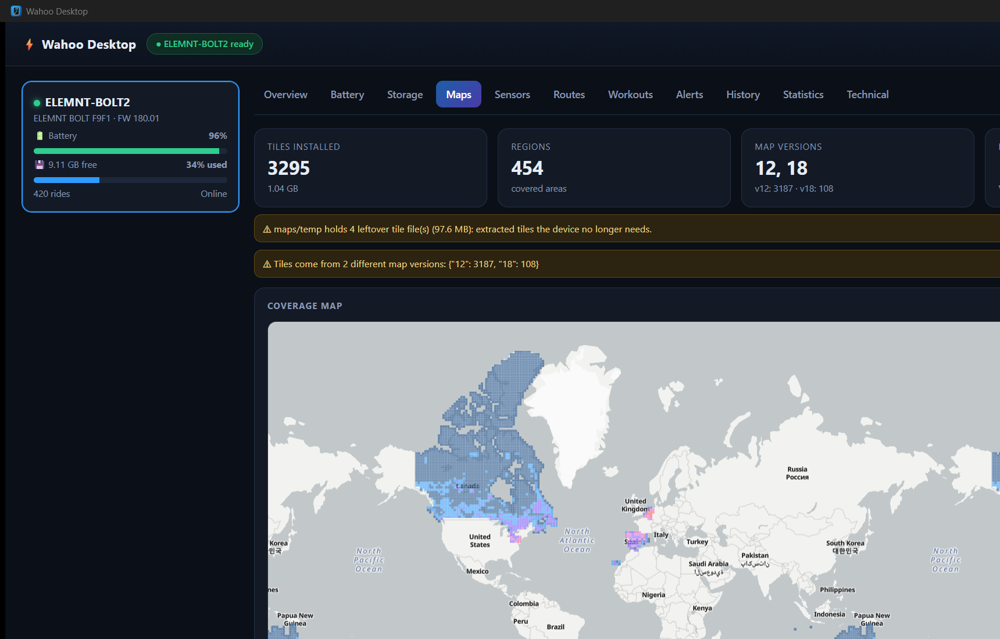
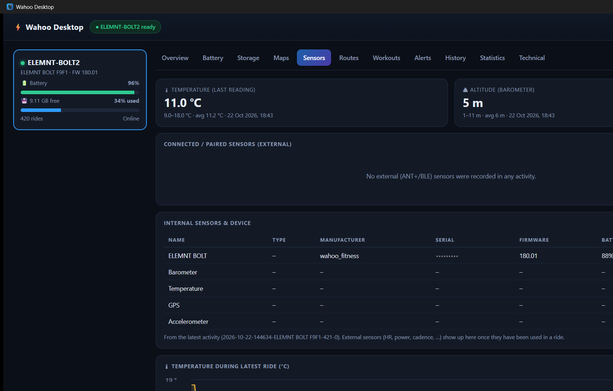
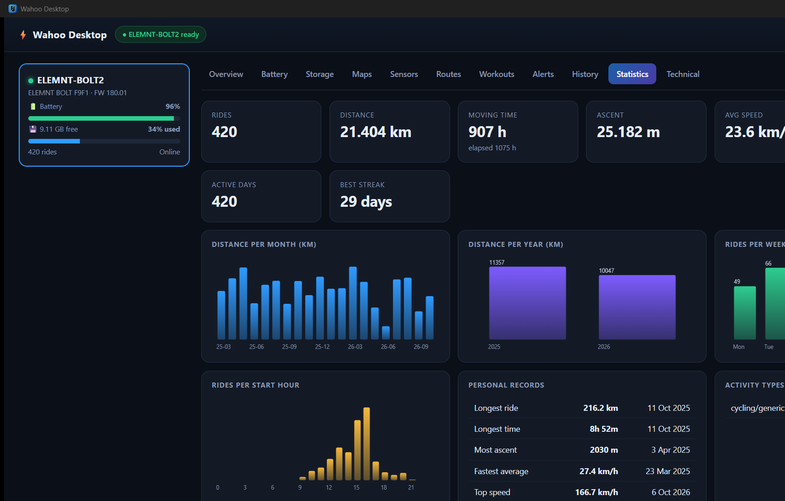
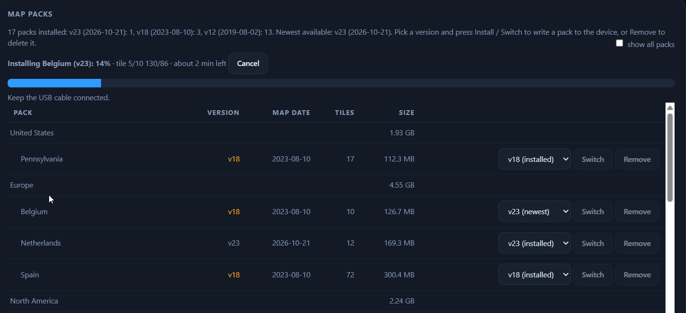

<p align="center"></p>

# Wahoo Desktop

## Introduction

Wahoo Desktop is a fast, local Rust app that reads a Wahoo ELEMNT (tested with an ELEMNT BOLT2) over **USB (MTP)** and shows everything it can find in a clean native window: firmware, battery, storage, installed maps, sensors, routes, workouts, alerts, ride history and statistics. No cloud account, no phone and no web server are needed; files are mirrored to a local cache so the UI is instant and works offline.

**Website:** https://bertt.github.io/WahooDesktop/

**Platform:** Windows only for now (native WPD COM API). macOS/Linux are planned. This is version 0.1.

## Welcome

Welcome, and thanks for reading! Feedback is very welcome: open an [issue](../../issues) with questions, bug reports or ideas, and send pull requests if you want to contribute.

Good starters:

- Test on another ELEMNT model (BOLT v1, ROAM, ROAM 2, ROAM 3, BOLT 3, ACE) and share the **Technical** tab output (without serial numbers)
- Pick an item from [Future ideas and extensions](#future-ideas-and-extensions), such as GPX/FIT export of rides
- Improve the docs (`docs/CLI.md`, `docs/MAPS.md`, `docs/ROUTING.md`) or add screenshots
- Add tests for FIT parsing (`src/fit.rs`) or route handling (`src/course.rs`)
- Start on macOS/Linux support for the device backend in `mtp/`
- Add another agent skill in [`skills/`](skills)
- Upload new maps (install a downloaded tile over USB) and routes (more formats, batch upload) to the device
- Support custom maps, for example tiles built from OpenStreetMap (see [docs/MAPS.md](docs/MAPS.md))

### Screenshots

| Maps | Sensors | Statistics |
| --- | --- | --- |
|  |  |  |

Installing a map pack (Maps tab: pick a version per pack, then Install / Switch / Remove, with progress):



## Supported devices

The app reads the device as a standard USB MTP storage device and parses its FIT files, so it should work with Wahoo ELEMNT head units that expose such storage. Only the BOLT2 has been verified.

| Device | Firmware | Status |
| --- | --- | --- |
| ELEMNT BOLT2 (BOLT F9F1) | 180.01 | Tested (all features) |
| ELEMNT BOLT (v1) | - | Untested, expected to work |
| ELEMNT ROAM / ROAM 2 | - | Untested, expected to work |
| ELEMNT ROAM 3 | - | Untested; newer platform (2025), folder layout may differ |
| ELEMNT BOLT 3 | - | Untested; newer platform (2025), folder layout may differ |
| ELEMNT ACE | - | Untested, expected to work |
| ELEMNT (original) | - | Untested; older firmware, folder layout may differ |

Notes: map, routing and storage details depend on the firmware's folder layout (`maps/`, `routes/`, `plans/`, `exports/`). Other devices may show missing sections. Reports with the **Technical** tab output are welcome. Wahoo KICKR/trainers and sensors are not supported.

## Installation

Download the file for your system from the [Releases](../../releases) page (replace `<version>` with the release, e.g. `0.1.3`). Only Windows has the desktop app and USB access to the ELEMNT; macOS and Linux get the command line tool `wahoo_cli` only (no device access: it reads the cache, shows map/firmware updates, etc.).

### Windows (desktop app + CLI)

Run `WahooDesktop-Setup-<version>-x64.exe` (Intel/AMD) or `WahooDesktop-Setup-<version>-arm64.exe` (ARM). It installs per user by default (no admin rights needed), adds a Start menu entry and optionally a desktop shortcut, and includes `wahoo_cli.exe`. Requires Windows 10/11 with the WebView2 runtime (preinstalled on current Windows). Silent install:

```powershell
.\WahooDesktop-Setup-<version>-x64.exe /VERYSILENT
```

### macOS (CLI only)

```bash
# Apple silicon: macos-arm64, Intel: macos-x64
sudo installer -pkg wahoo_cli-<version>-macos-arm64.pkg -target /
wahoo_cli --help
```

The package is not signed. If macOS blocks it, allow it under System Settings > Privacy & Security, or remove the quarantine flag first: `xattr -d com.apple.quarantine wahoo_cli-<version>-macos-arm64.pkg`.

### Linux (CLI only)

```bash
# Debian/Ubuntu (amd64 or arm64)
sudo apt install ./wahoo-cli_<version>_amd64.deb

# Fedora/RHEL/openSUSE (x86_64 or aarch64)
sudo dnf install ./wahoo-cli-<version>-1.x86_64.rpm

wahoo_cli --help
```

### From source

See [Build and run](#build-and-run).

**Using the desktop app (Windows).** Connect the ELEMNT with a data cable, switch it on, start Wahoo Desktop and click **Sync device**.

## Features

- Device list with online/offline state, battery and storage
- Overview, firmware/hardware, serial and factory info
- Firmware update check: compares the installed version with Wahoo's public manifest (`version.json-<model>`) and shows "up to date" or "update available" (also `wahoo_cli firmware`; one of two features that use the internet, and it fails gracefully offline)
- Map update check: resolves tile pack ids to names and compares each pack's version with the newest map version on Wahoo's public CDN (Maps tab, `wahoo_cli map-updates [--tile x/y]`)
- Map packs: the Maps tab lists the pack tree (continent > country > region); installed packs show their version and the date of that map version. Per pack pick any published version (older or newer) and press Install (new pack) or Switch, or Remove an installed pack. A confirmation card shows tiles, download size, space and duration; progress and Cancel are shown, then the app syncs and asks you to restart the ELEMNT. CLI: `wahoo_cli map-packs`, `install-pack`, `remove-pack`, `map-download` (saves tiles to `%LOCALAPPDATA%\WahooDesktop\maps\<version>`, CLI only). The "leftover tile files in maps/temp" warning has a Clean up button (CLI: `clean-maps --apply`).
- Battery history, drain and estimated runtime
- Storage breakdown by folder
- Maps: installed tiles on a map (colour by size/version/marker), versions, leftover temp files, warnings
- Routing: own tab (and `wahoo_cli routing`) with the Valhalla graph tiles: count per level and a coverage map built from `maps/routing_md5` (cached by `sync`, so run a sync once after updating), the service config and the routing size of installed packs (see [docs/ROUTING.md](docs/ROUTING.md))
- Sensors (from FIT files), saved routes (click to view on a map; drag and drop a .gpx/.fit to add one to the device), planned workouts, derived alerts
- History: sortable/filterable activity list; details with map, charts, laps, events and raw FIT message debug
- Statistics: totals, per month/year/weekday/hour, personal records
- Technical tab: raw MTP info, raw file browser
- Connection check: distinguishes "attached and ready" from "USB attached but device off / charge-only"

## Build and run

```
cargo build --release
target\release\wahoo-desktop.exe
```

The app opens its own native window (WebView2, no web server or open port). Maps use the OpenFreeMap basemap (needs internet).
Connect the ELEMNT with a data cable, switch it on and click **Sync device**. Files are mirrored to `%LOCALAPPDATA%\WahooDesktop\cache`, so the UI is instant afterwards and works offline.

## CLI

```
wahoo_cli status | sync | info | battery | storage | maps | sensors
wahoo_cli routes | add-route <file.gpx|file.fit> | plans | alerts | history -n 20 | activity <id> | stats | debug
wahoo_cli map-updates [--tile x/y] | map-packs [--all] | map-download <pack|id> [--version n] | install-pack <pack|id> --version n [--apply] | remove-pack <pack|id> [--apply] | clean-maps [--apply] | install-tile <x/y> --version n [--apply]
wahoo_cli routing | routing-export <tile id|file> [-o out.geojson]
wahoo_cli pull <device path> <local file>
wahoo_cli ls [prefix]
```

Global flags: `--json`, `--device <name>`.

Full documentation with all commands and examples: **[docs/CLI.md](docs/CLI.md)**.

## Skills

The [`skills/`](skills) folder contains agent skills: Markdown files with instructions that let an AI coding agent (for example GitHub Copilot CLI or Claude Code) drive `wahoo_cli` safely. Each file has a `name` and `description` in its front matter.

| Skill | File | Purpose |
|-------|------|---------|
| `wahoo-device-diagnose` | [device-diagnose.md](skills/device-diagnose.md) | Diagnose connection, cache and sync problems |
| `wahoo-ride-analysis` | [ride-analysis.md](skills/ride-analysis.md) | Summarize and compare rides and statistics |
| `wahoo-route-upload` | [route-upload.md](skills/route-upload.md) | Add a GPX/FIT route to the device (asks for confirmation) |
| `wahoo-update-check` | [update-check.md](skills/update-check.md) | Check firmware and map updates (needs internet) |

### How to use

1. Build or install `wahoo_cli` and make sure it is on your `PATH` (or run it via `cargo run --release --bin wahoo_cli --`).
2. Install a skill by copying its file into your agent's skills folder, for example `~/.copilot/skills/<skill-name>/SKILL.md` or `.claude/skills/<skill-name>/SKILL.md` (use the skill's `name` as folder name and `SKILL.md` as file name).
3. Connect the ELEMNT with a data cable, switch it on, and ask your agent a question.

The skills follow the same rules as the CLI: always `--json`, sync only when fresh data is needed, never sync while the desktop app is syncing, confirm before `add-route` or large downloads, and never share serial numbers or `debug` output publicly.

### Example prompts

- "Check why my Wahoo is not visible."
- "Run a diagnosis and give only the necessary next step."
- "Summarize my last 5 rides."
- "Compare my longest ride this month with the previous one."
- "Put this GPX route on my Wahoo."
- "Is my route on the device yet?"
- "Is there new firmware for my Wahoo?"
- "Are my maps up to date?"

## Map data: source and format

Summary (reverse-read from the device, not official documentation):

- Maps are stored as one Mapsforge map per zoom-8 slippy tile: `maps/tiles/8/<x>/<y>.map.lzma` (LZMA-compressed, 2-15 MB typical), with a zero-byte version marker next to it.
- Wahoo's map CDN (`https://cdn.wahooligan.com/wahoo-maps`) cannot be listed (403), but its objects are public: `<version>/mappack-gzip.json.gz` (tile pack list) and `<version>/tiles/8/<x>/<y>.map.lzma` (tiles). This makes a map update check possible.
- Community tools show that tiles can also be built from OpenStreetMap and copied to the device over USB.

Full details (layout, formats, tile maths, versions, building your own maps): **[docs/MAPS.md](docs/MAPS.md)**. Valhalla routing data: **[docs/ROUTING.md](docs/ROUTING.md)**.

## Limitations

- **Map packs can be installed, switched and removed (GUI and `install-pack` / `remove-pack`).** Any published map version works per pack (also older ones), one pack at a time; there is no "update all". Only the ELEMNT BOLT2 with firmware 180.01 is verified, and new-tile writing, downgrades and removal are only lightly tested on hardware: start with a small pack. Single tiles: `wahoo_cli install-tile` (see [docs/MAPS.md](docs/MAPS.md)).
- Alerts are derived (low storage/battery, staged firmware, crash files, leftover maps); the device does not store alert definitions in readable form.
- Live battery/sensor data over Bluetooth is not implemented.

## Future ideas and extensions

- macOS/Linux backends (e.g. the `mtp-rs` crate)
- Bluetooth (btleplug) for live battery and sensor status
- Wahoo Cloud API integration
- Firmware update check is implemented; a future step is a one-click download of the update package
- GPX/FIT export of rides; deleting files from the device
- Segment analysis (FIT `segment_lap`), heatmap of all rides
- Sensor battery alerts, multi-device comparison
- Reclaiming space from `maps/temp`
- Ride selector for the sensor charts, decoding of manufacturer FIT messages
- Install a newer tile from the CDN over USB (download, keep the original, update the version marker)
- Build up-to-date Valhalla routing tiles (e.g. from fresh OpenStreetMap data) and put them on the device, so current detours and road works show up in routing on the Wahoo (see [docs/ROUTING.md](docs/ROUTING.md))

## Building the installer and releases

The Windows setup is built with [Inno Setup](https://jrsoftware.org/isinfo.php) (`installer/wahoo-desktop.iss`). The GitHub Actions workflow `.github/workflows/release.yml` runs when a GitHub release is published: it takes the version from the tag (e.g. `v1.2.3`), stamps it into `Cargo.toml`, runs the tests, builds in release mode, builds `WahooDesktop-Setup-1.2.3.exe` and attaches it to the release. It can also be started manually (workflow_dispatch) to build an installer artifact without publishing.

The workflow builds a Windows installer for x64 and arm64 (`WahooDesktop-Setup-<version>-<arch>.exe`, GUI + CLI). For macOS and Linux it builds CLI-only packages for x64 and arm64: `wahoo_cli-<version>-macos-<arch>.pkg` (installs to `/usr/local/bin`) and `wahoo-cli_<version>_<arch>.deb` / `.rpm` (installs to `/usr/bin`). The CLI is built with `cargo build --release --no-default-features --bin wahoo_cli --target <triple>`; the `gui` feature (tao/wry, on by default) is left out so no GTK/WebView libraries are needed. Device access (MTP/WPD) only works on Windows; on macOS and Linux device commands report "unsupported" and the CLI only has the cache and the internet commands (cache in `~/Library/Application Support/WahooDesktop` or `~/.local/share/WahooDesktop`).

To build locally: `cargo build --release`, then `ISCC /DAppVersion=0.1.3 installer\wahoo-desktop.iss` (output in `dist\`). The icon source is `assets/icon.svg`; `assets/make-icon.cjs` regenerates `icon.ico`/`icon.png`.


